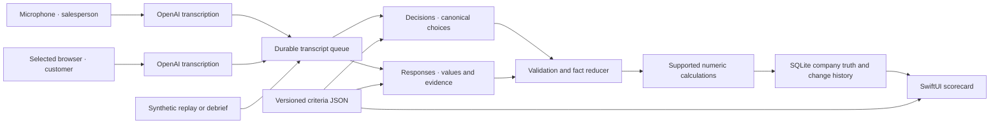

# Architecture

The app is a native SwiftUI overlay. It uses macOS frameworks for audio capture, Keychain for credentials, SQLite for local state, and cloud OpenAI APIs for inference.

## Commit rules

Every extraction job carries company/call identity, configuration revision, transcript revisions, and field versions. The main-actor reducer checks those again after network calls return. Manual edits can proceed during requests; a late response cannot undo them. Locks protect values from inference and arithmetic. Conflicts become proposals; accepting a proposal retains the lock. Contradictory direct numeric inputs remain intact and show a calculation-conflict explanation; invalid negative derived values are never displayed.

Calculation targets are explicitly identified in the extraction request: the model should return a directly spoken value or range midpoint, leaving sums, differences and percentages inferred from other quantities to the deterministic calculator. Formulas support optional `comparison_tolerance` in absolute target units. It affects conflict/proposal comparison only; it never changes a direct or locked value and does not alter `decimal_places` for derived answers. Omission retains the previous strict comparison. Catalog revision 15 opts into 0.05 percentage points for return-mix comparisons, so a stated 77.2% agrees with a calculated 77.19%; a materially different stated percentage still produces a conflict. Counts and currency do not opt in. JSON import rejects negative or nonfinite tolerances and preserves the setting on export.

HTTP text requests use a three-second Decisions timeout and six-second Responses timeout, with an eight-second resource ceiling. These bounds were selected after about 1,900 successful requests per endpoint showed Decisions maximum1.55s and Responses p99 4.34s, while15-second transport stalls delayed following sentences. A timeout does not guarantee an update within five seconds; the durable queue still retries at most three times and retains failed work. Failed/cancelled transport requests keep their conservative billing reservation and record only endpoint/timing metadata. Cancellation is propagated as cancellation, not retried as a network error. These newer bounds need an additional live benchmark before claiming a latency improvement.

Evidence quotes must occur in the referenced final transcript segment. Fixed choices ordinarily require agreement between Decisions and structured extraction. Up to four high-confidence extracted fields that fail classification may receive one focused Decisions recheck. The same quote, speaker, configuration, version and lock guards still apply; there is no recursive classification retry.

Numeric fields can opt into `requires_evidence_gate`. After structured extraction, one bounded Decisions request checks the exact proposed quantities and their supporting quotes against each field definition, using preceding conversation to interpret short answers. Candidates must first pass the local evidence, speaker, version and lock checks; fabricated evidence does not trigger a paid check. Only `supported` permits an extracted candidate, and its confidence is capped by the gate confidence; missing or invalid decisions leave the old answer intact. This gate does not use the fixed-option recheck to override a rejection. Catalog16 enables it for firm total/personal/business returns and individual-return percentage after a long replay confused an evaluation sample and rollout purchase target with annual firm volume. It is an additional model check, not a deterministic guarantee of semantic accuracy. New-firm annual estimates remain allowed; seller-product purchase targets do not become firm volume.

A field may explicitly opt into `allow_tentative_named_other`. For an unlisted name occurring verbatim in the supporting quote, a high-confidence structured extraction can supply a provisional Other value despite classifier disagreement or low confidence. The displayed confidence is capped at the field's tentative threshold, so it stays red. This path only fills an empty, unlocked field from direct customer speech or explicit debrief, never an existing answer. It cannot turn a listed option/alias into Other or bypass a refused, missing or invalid classifier answer. This is a heuristic provisional policy, not a calibrated probability. Explicitly named values outside the supplied catalog use Other with a detail. Unknown stays null. New replies that contradict a filled answer require the replacement threshold. Thresholds are tunable heuristics, not calibrated probabilities.

Company truth is shared across that company's calls within a configuration namespace. Old fields and configurations stay stored when a catalog changes. A switch atomically supersedes pending jobs and reprocesses this call against the selected catalog. A generation check discards late results from the old configuration.

## Audio and recovery

Capture begins only after an explicit Start. Microphone and selected-browser audio use independent streams to distinguish salesperson from customer. PCM is converted to mono 24 kHz; a lightweight energy detector creates bounded speech chunks. The default is OpenAI cloud transcription. Apple Speech is opt-in; there is no local LLM or silent provider fallback.

Each cloud channel retains at most 12 unfinished audio turns in memory. It can reconnect twice after a network failure, resend those turns with the original client IDs, and ignore late replies from the previous connection. Quota, authentication, invalid protocol, and budget failures stop automatically. Final drain is bounded to eight seconds; missing audio is reported. Raw audio is not persisted for crash recovery. Final transcript jobs are durable and can resume from History.

Extraction is serial per call, with concurrent Decisions/Responses requests and up to four queued sentences coalesced into one job. At most 128 pending jobs are loaded into the active page; overflow stays in SQLite and recovery follows transcript sequence. Transient text failures allow at most three attempts per durable job. Quota, authentication, budget, and rate-limit failures require an explicit retry.

## Measurement

Replay arrivals use fixed clock deadlines independent of API response timing. Reports distinguish queue delay, processing time, and sentence-arrival-to-database-commit latency. A separate distribution covers batches that committed updates. The native UI records visible-row update callbacks, which are not physical display scan-out measurements. A real Meet audio-to-screen trial is still required for that end-to-end claim.

A persisted ledger estimates text cost from returned usage and reserves audio cost before upload, including retransmitted audio. Settings shows the estimate and a cumulative local allowance. This protects local requests; it does not change OpenAI account billing or purchase credits.
